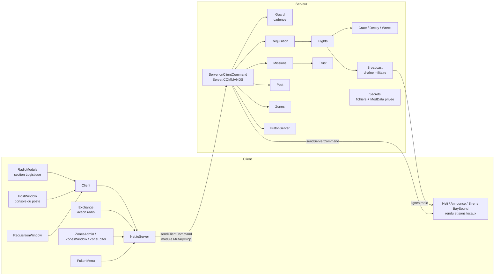

# Architecture de Military Drop

État au 2026-10-21, version 0.5.4 (`modversion` de `mod.info`), Build 42.21. Les contrats détaillés (commandes, ModData, fichiers, options) sont dans [specifications-techniques.md](specifications-techniques.md) ; ce document décrit l'organisation et les flux.

Dans ce document, `lua/` désigne `Contents/mods/batman_MilitaryDrop/42.21/media/lua/` et chaque module `MilitaryDrop_X.lua` est cité par son nom court `X`.

## Vue d'ensemble

Le mod est **autoritaire côté serveur** : le client affiche, fait parler le personnage et envoie des demandes ; le serveur (ou le solo, où les deux côtés partagent le même Lua) revérifie tout et décide. Aucun secret (code, graine, fréquence libre, état de confiance) n'est lisible par un client.



## Arborescence du mod

```
Contents/mods/batman_MilitaryDrop/
  common/                  dossier common exigé par la Build 42
    README.txt
    media/                 ressources : models_X (caisse, épave, ballon), textures, sound, clothing
  42.21/
    mod.info               id=batman_MilitaryDrop, versionMin=42.21, require=\batman_BeltRadio
    poster.png, icon.png
    media/
      lua/shared|client|server/MilitaryDrop/   code
      lua/shared/Translate/<LANGUE>/           traductions JSON (8 langues)
      scripts/                                 objets, recettes, sons, modèles, véhicules
      sandbox-options.txt                      options du bac à sable (page MilitaryDrop)
```

Une seule variante de version (`42.21`). `mod.info` ne déclare ni `loadModAfter` ni `incompatible`. `require=\batman_BeltRadio` rend Belt Walkie-Talkie obligatoire depuis la 0.5.1 ; TooltipLib est exigé par Belt Walkie-Talkie, pas par ce `mod.info`.

## Modules Lua

Seule globale : la table `MilitaryDrop` (`Core`), dont chaque module est un champ (`MilitaryDrop.Server`, `MilitaryDrop.Trust`…). Les fichiers serveur commencent par `if isClient() then return end` ; ils tournent donc sur un serveur MP et en solo.

### `shared/`

| Module | Rôle |
|---|---|
| `Core` | Espace de noms, journal `MilitaryDrop.log`, lecture des options (`Config.get`, à chaque appel), détection des changements à chaud (`Config.poll` chaque minute de jeu, `Config.onChange`). |
| `Net` | Couche réseau : `toServer`, `toPlayer`, `toAll` ; en solo, appel direct du gestionnaire de l'autre côté. |
| `Codes` | Code d'authentification (deux mots OTAN + deux chiffres), code périodique dérivé de la graine, chiffrement de la station de chiffres (générateur Park-Miller, calcul pur). |
| `Radio`, `RadioLib` | Reconnaissance des radios militaires (`getIsHighTier`), références de radio échangées avec le serveur ; `RadioLib` charge le récepteur commun de Belt Walkie-Talkie (prérequis) et vérifie son niveau d'API. |
| `Exchange` | Échange radio avec la base : prise en main de la radio, action chronométrée `MilitaryDrop.ExchangeAction`, envoi de la commande, réponse traduite côté client (`ExchangeReply`). |
| `Flight`, `Crash` | Trajectoire de l'hélicoptère (calcul pur partagé serveur/clients) ; décision et géométrie d'un crash Mayday. |
| `Loot`, `Lots` | Tirage du contenu des caisses dans les tables de butin fusionnées (aucun nom d'objet) ; les 18 lots du formulaire de réquisition. |
| `Recipe`, `Salvage`, `Memo`, `PrintMedia` | `OnCreate` des recettes (ouverture des caisses, des lots d'épave) et des documents ; mise en page `printMedia`. |
| `Dismantle`, `SirenAction`, `WreckParts`, `WreckSmoke` | Démontage de la caisse (règles vanilla du bois), action « Couper la sirène », pièces d'épave (enveloppes des actions vanilla de véhicule), fumée locale de l'épave. |
| `Fulton`, `FultonFlight` | Classement et barème du contenu d'un kit Fulton ; trajectoire visuelle du ballon. |

### `client/`

| Module | Rôle |
|---|---|
| `Client` | Appel de largage, réponses de la base, table `Client.HANDLERS` des commandes serveur, fichier local du code saisi, options admin du menu contextuel. |
| `RadioModule` | Section « Logistique » ajoutée à la fenêtre radio vanilla (`ISRadioWindow.createChildren` enveloppée). |
| `ExchangeMenu` | Options d'échange (rapport, plaques, reconnaissance, contrôle, nettoyage, Fulton) utilisées par `RadioModule`. |
| `RequisitionWindow` | Formulaire de réquisition (lots, budget, leurre, secteur). |
| `PostWindow`, `BaySound` | Console du poste de liaison, baie de lecture de l'enregistreur de vol et ses sons. |
| `Heli`, `Announce`, `Siren` | Hélicoptère vu et entendu (son, ombre, flèche), repères de carte des auditeurs, sirène du leurre ; tout est local, sans paquet. |
| `ZonesAdmin`, `ZonesWindow`, `ZoneEditor` | Outil d'admin des zones de largage (bouton du panneau d'admin vanilla en MP, menu de debug en solo). |
| `FultonClient`, `FultonMenu`, `FultonRender`, `FultonRender_Debug` | Créneau Fulton reçu de la base, menu du kit et action de lâcher, rendu du ballon et menu de test (debug). |
| `DismantleMenu`, `WreckMenu`, `GroundFire`, `BeltRadio` | Menu « Démonter la caisse », récupération de l'épave (enveloppe d'`ISVehicleMenu.FillMenuOutsideVehicle`), signal d'un tir vers l'hélicoptère, inscription des chaînes du mod au récepteur de ceinture. |

### `server/`

| Module | Rôle |
|---|---|
| `Server` | Point d'entrée des commandes (`Server.COMMANDS`, `onClientCommand`), évaluation d'un appel, choix du point, livraison, rappels de grille. |
| `Guard` | Cadence par joueur et par clé (anti-rafale, mémoire seule). |
| `Secrets` | Graine et code fixe dans des fichiers du serveur ; nom et accès de la ModData privée. |
| `Broadcast`, `NumbersStation` | Chaîne militaire dynamique (annonces, MAYDAY, missions) et station de chiffres. |
| `Flights`, `Crate`, `Decoy`, `Wreck`, `Smoke` | Vols côté serveur, caisse-véhicule et son coffre, leurre à sirène, site de crash, fumée Signal Smoke. |
| `Requisition`, `LotsFile` | Autorisations et commandes du formulaire ; fichier `requisition.txt` (lecteur de données sans exécution). |
| `Trust`, `Teams`, `Missions` | Réputation personnelle, équipes (factions vanilla), sources de confiance et missions publiques. |
| `Post` | Poste de liaison : installation, journal, dépôt de plaques, enregistreur de vol. |
| `Zones`, `ZonesFile` | Zones de largage (`dropzones.txt`) et protocole de l'outil d'admin. |
| `FultonServer`, `FultonLoot`, `FultonFlightServer` | Lâcher Fulton et paiement, butin Fulton, vols de ballon autoritaires. |
| `Notes`, `Documents`, `ServerTranslations` | Notes et carnets sur les zombies et dans le butin, mises en page, rechargement des traductions sur un serveur MP. |

Chaque module serveur inscrit ses propres commandes dans `Server.COMMANDS` (voir [specifications-techniques.md](specifications-techniques.md#commandes-réseau)).

## Flux principaux

1. **Appel de largage** : `RadioModule` → `Client.call` → `Request` → `Server.handleRequest` (cadence, droits, radio, canal et code, ligne coupée, délai) → réponse `Result`. Avec `RequisitionForm`, le serveur ouvre une autorisation (`Requisition.openForm`, réponse `form`) ; `RequisitionOrder` est revérifié puis `Server.launchDrop` → `Flights.launch`.
2. **Vol** : `Flights` avance chaque vol sur `OnTick`, envoie `FlightStart`/`FlightSync`/`FlightEnd`, fait du bruit, annonce la grille (`Broadcast` + `DropAnnounce`) ; un crash éventuel (`Crash.roll`, `GroundFire`, `AdminCrashNext`) passe par `Wreck`.
3. **Livraison** : quand la case est chargée (`LoadChunk`, sondage), `Crate` crée le véhicule `Base.MilitaryDrop_SupplyCrate`, son coffre est rempli par `OnFillContainer`, la horde apparaît ; leurre : `Decoy.onDelivered`. `Server.pollCollected` (chaque minute) clôt le largage quand une caisse est ouverte ou vidée.
4. **Confiance** : `Exchange` → commandes `Mission*` → `Missions` → `Trust.add` ; missions planifiées sur `EveryTenMinutes`, nettoyage suivi par `OnZombieDead`.
5. **Poste de liaison** : commandes `Post*` → `Post` ; journal rafraîchi chaque minute (`EveryOneMinute`), état relu au `LoadChunk`.
6. **Fulton** : `MissionFulton` ouvre un créneau ; `FultonLaunch` → `FultonServer.launch` (revérification complète) → paiement, vol `FultonFlightServer`, `Snapshot` aux clients.
7. **Zones** : `ZoneList`/`ZoneAdd`/… → `Zones.handleCommand` (droit `ChangeAndReloadServerOptions`, cadence) → `ZonesFile` écrit `dropzones.txt`, réponses `ZoneReply` puis `ZoneListReply`.

Événements du jeu les plus utilisés : `OnGameStart`, `OnTick`, `OnInitGlobalModData`, `OnFillWorldObjectContextMenu`, `EveryOneMinute`, `OnServerStarted`, `LoadChunk`, `OnLoadRadioScripts`, `OnClientCommand`/`OnServerCommand`, `EveryTenMinutes`, `EveryHours`, `OnZombieDead`, `OnFillContainer`, `OnSpawnVehicleEnd`, `OnDeviceText`, `OnPostDistributionMerge`.

## Persistance

- **ModData globale publique** `MilitaryDrop` : heure du dernier largage, vols, livraisons en attente. Lisible par tout client : rien de secret.
- **ModData globale privée** `MilitaryDrop_<12 hex>` (nom dérivé de la graine) : largages, confiance par personnage, équipes, missions, postes, sirènes, épaves. Jamais transmise.
- **Fichiers du serveur** sous `Zomboid/Lua/MilitaryDrop/` : graine et code fixe par partie, `requisition.txt` et `dropzones.txt` communs au compte système.
- **ModData d'objets** : identifiant de largage sur les caisses, lot d'une caisse de réquisition, uid du poste, site de crash, identifiant de personnage sur l'`IsoPlayer`.

Migrations présentes : notes collectives de la v1.3 conservées sans transfert (`missions.characterSchema = 1`, ancienne table `trust`), lecture d'enregistreur en fraction (`recorderReadsFraction = 1`), code fixe repris de l'ancienne ModData publique, monde neuf détecté par `OnLoadRadioScripts` (graine et code tirés de nouveau). Détail : [specifications-techniques.md](specifications-techniques.md#persistance).

## Intégrations et points d'extension

- **Belt Walkie-Talkie** (`batman_BeltRadio`, requis) : récepteur commun des talkies à la ceinture (`BatmanRadioSupport`), sans copie embarquée (retirée en 2026-10).
- **Signal Smoke** (`batman_SignalSmoke`, requis depuis le 2026-10-21 : `require=` et objet requis sur Steam) : fumée verte sur la caisse posée. Les gardes de `MilitaryDrop.Smoke` (mod actif par `getActivatedMods`, module chargé) restent : sans lui, aucune fumée et aucune erreur.
- **HEF – Helicopter Event Framework** (facultatif) : lecture seule de `HTT.Server.state`, départ retardé si un de ses événements est actif près de la cible.
- **Zombie Virus Vaccine** (`ZVirusVaccine42BETA`, facultatif) : reconnu par le barème Fulton (remède).
- **Mods de butin** : le contenu des caisses et des lots vient des tables fusionnées ; `MilitaryDrop.Loot.CASES[type].sources` est remplaçable par un mod de compatibilité. Le marqueur `resetedContainers` protège la caisse contre les mods qui re-remplissent les coffres de véhicules.
- **Extension interne** : `Server.COMMANDS`, `Client.HANDLERS`, `Exchange.HANDLERS`, `Config.onChange`.

## Outillage

- `tests/run_tests.py [--require-luacheck]` : luacheck, syntaxe Lua 5.1, scripts, traductions, descriptions Steam (8 000 octets), suivi `docs/annexes/plans/SUIVI.md`, tests Lua `tests/lua/test_*.lua` sous `lupa` (API du jeu simulée par `tests/lua_harness.py`), protocole Fulton MP (`tests/check_fulton_multiplayer.py`).
- `tests/check_mayday_assets.py` : modèles et textures de l'épave.
- CI : `.github/workflows/checks.yml` (Ubuntu, Python 3.12, luacheck, lupa, pillow).
- `tools/wiki_sync.py` : publie `docs/wiki/` vers le wiki GitHub (voir [docs/README.md](README.md#wiki)).
- `source/` : sources des ressources et outils d'aperçu hors jeu (caisse, épave, documents, console, formulaire, section radio, sons).
