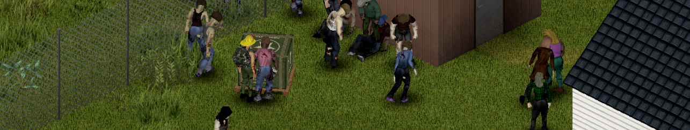

# Military Drop: player's guide

> Guide for the unpublished local 0.8.0 branch. Public pages may still describe the previous release.

[Français](../fr/Home.md) · [Guide home](../Home.md)

Military Drop is a Project Zomboid Build 42.21 mod: call the army by radio, fill a requisition form, and race the dead to the supply crate.

1. [Getting started](01-getting-started.md): install, what you need, single player and multiplayer, compatibility.
2. [Calling a drop](02-calling-a-drop.md): frequency, weekly code, numbers station and codebook, the radio's Logistics section, helicopter, crate and horde.
3. [Requisition form](03-requisition-form.md): budget, tiers, the 18 lots, requisition cases, siren decoy.
4. [Trust and missions](04-trust-and-missions.md): personal reputation, gains/losses table, migration from collective scores, reports, dog tags, recon, clearance and radio checks.
5. [Liaison post](05-liaison-post.md): turn a fixed military radio into your station's console.
6. [Server admin](06-server-admin.md): sandbox options, requisition lots file, drop zones for PvP servers, admin tools, files, debug commands.
7. [Fulton extraction](07-fulton.md): send intelligence and gear by balloon for trust.
8. [FAQ](08-faq.md)
9. [Helicopter crash](09-helicopter-crash.md): the MAYDAY, the crash site, wreck salvage and the flight recorder.

10. [RJ-93 radio jammer (optional)](10-radio-jammer.md) : recipe, battery, controls and interference.
