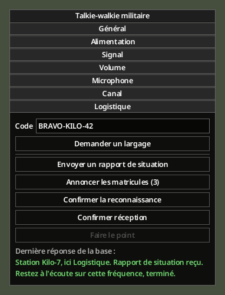
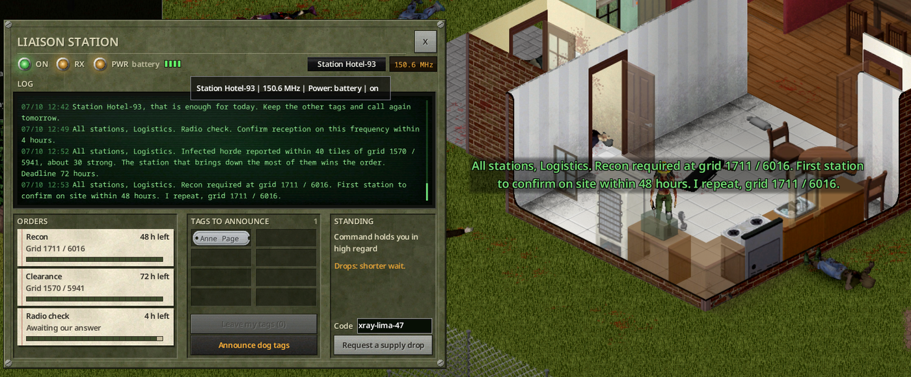

# Confiance et missions

[English](../en/04-trust-and-missions.md) · [Sommaire du guide](Home.md) · Précédent : [Formulaire de réquisition](03-requisition-form.md) · Suivant : [Poste de liaison](05-liaison-post.md)

## Breaking change en 0.1.2

**BREAKING CHANGE — 0.1.2 :** Réputation par personnage, indépendante du compte et de la faction. Les anciennes notes collectives ne sont pas transférées : les personnages existants commencent à 25. Les anciens largages ne modifient pas ces nouvelles notes.

## Votre station

Pour la base, votre groupe est une **station** avec un indicatif, par exemple « Station Kilo-7 ». En multijoueur, une station est une faction ; un joueur sans faction forme une station à lui seul. En solo, vous êtes une station.

La base tient une note de **confiance personnelle** pour chaque personnage, de 0 à 100. Un nouveau personnage part de **25**, même sur le même compte. Sa note reste la même après sauvegarde, reconnexion ou changement de faction. Vous ne voyez jamais le chiffre : la base vous le dit en mots, par le ton de ses réponses et sur la console du [poste de liaison](05-liaison-post.md) :

| Confiance | Ce que dit le commandement |
|---|---|
| moins de 25 | Le commandement se méfie de vous |
| 25 à 49 | Le commandement reste prudent |
| 50 à 74 | Le commandement vous fait confiance |
| 75 et plus | Le commandement vous tient en haute estime |

## Ce que change la confiance

- **Attente entre deux largages** : normale à 50, plus longue en dessous (×1,25 au départ, ×1,5 à 0), plus courte au-dessus (×0,6 à 100).
- **Réquisition** : un budget plus gros et les paliers supérieurs (II à 50, III à 75). Voir [Formulaire de réquisition](03-requisition-form.md).
- **Ligne coupée** : sous **15**, la base refuse vos largages pendant **3 jours** de jeu.

## Gagner et perdre de la confiance

Valeurs par défaut et durées en jeu.

| Cause | Personnage concerné | Gain / perte |
|---|---|---|
| Le demandeur ouvre la première caisse | Demandeur uniquement | +10 |
| Un autre membre de la faction de l’appel ouvre la première caisse | Demandeur uniquement | +5 |
| Un personnage extérieur ouvre la première caisse | Demandeur uniquement | −5 |
| Aucune caisse ouverte dans les 48 h après livraison | Demandeur uniquement | −10 |
| Premier rapport de situation du jour | Émetteur | +1 |
| Chaque plaque nominative valide et inédite | Émetteur | +2 |
| Première reconnaissance confirmée à 25 cases / sous 48 h | Premier à confirmer | +3 |
| Plus de victimes admissibles à l'objectif commun du nettoyage | Personnage ayant le plus de victimes | +5 |
| Contrôle confirmé sous 4 h, une fois par personnage | Chaque répondant, une fois | +1 |
| 3 codes faux / appels sur mauvaise fréquence en 1 h | Auteur des appels | −2 |
| Érosion optionnelle après 24 h sans contact | Personnage sans contact | −1 / +1 |

- Seule la première caisse de ravitaillement ouverte compte par largage. Un autre ouvreur reçoit **0** ; son appartenance est vérifiée à l’ouverture dans la faction enregistrée lors de l’appel.
- Les gains positifs hors largages partagent un plafond quotidien par personnage (**+10/jour** par défaut, option serveur `TrustDailyCap`). La note reste entre **0 et 100**.
- Depuis le poste, le bonus de 50 % est arrondi : rapport **+2**, plaque **+3**, reconnaissance **+5**, contrôle **+2**. Ces gains restent plafonnés. Le nettoyage reste à **+5**.
- Trois appels avec code faux ou mauvaise fréquence en moins d’une heure entraînent **−2**, au prochain changement d’heure, au maximum une fois par heure.
- L’érosion est **désactivée par défaut**. Après 24 h sans contact, elle rapproche la note de 25 d’un point par jour (−1 au-dessus, +1 en dessous, 0 à 25).
- Missions expirées, largages forcés par un admin et leurres : variation **0**. Un changement de faction donne aussi **0**. Un nouveau personnage part de **25**.

Ces échanges ne demandent **aucun code** : seulement une radio militaire réglée sur la fréquence militaire. Ils sont dans la section **Logistique** de la fenêtre radio (**Options de l'appareil**).

*Rendu hors jeu.*

## Rapport quotidien

**Envoyer un rapport de situation** : une fois par jour de jeu. Un second rapport le même jour est poliment refusé.

## Plaques d'identité

Les zombies militaires laissent les plaques d'identité du jeu, gravées au nom du soldat. **Annoncer les matricules (N)** lit les noms à la base :

- votre propre plaque et les plaques vierges ne comptent pas, ni une plaque portée ou tenue en main ;
- chaque matricule ne compte qu'une fois ; une plaque annoncée est mise de côté ;
- quand la limite du jour est atteinte, la base le dit et vous gardez les autres plaques pour plus tard.

## Missions

De temps en temps, la base donne un ordre à **toutes les stations** sur la fréquence militaire. Les missions sont publiques. Tant qu'un ordre de reconnaissance ou de nettoyage est ouvert, la base répète sa grille toutes les **6 heures** de jeu par défaut (même option que les rappels des largages). La reconnaissance reçoit aussi un repère automatique, même si vous manquez l'annonce ; le nettoyage reste marqué à la réception de l'annonce, d'un rappel ou d'une réponse de la base.

*En jeu (version anglaise).*

### Reconnaissance

*« À toutes les stations, ici Logistique. Reconnaissance demandée en grille X / Y. Premier survivant à confirmer sur place dans les 48 heures. »*

Un symbole **œil** bleu marque automatiquement la grille sur votre carte dès le lancement, y compris après reconnexion si la mission est encore active. Il disparaît à sa clôture. Allez-y et appuyez sur **Confirmer la reconnaissance** à **25 cases** au plus du point. Le premier personnage gagne +3. Trop loin, la base vous redonne la grille.

### Nettoyage

À la réussite, chaque participant connecté reçoit une notification indiquant sa contribution et son gain réel de confiance, même si le plafond quotidien limite ce gain à zéro. La récompense reste attribuée au meilleur contributeur selon les règles ordinaires. Le crâne et le cercle sont remplacés par une **coche verte pendant une heure de jeu**, puis retirés automatiquement ; une reconnexion conserve seulement la durée restante.

Le poste de liaison conserve les **20 derniers résultats de nettoyage** sous « Missions terminées » : résultat, grille, date de clôture, votre contribution et votre gain de confiance. L'historique reste consultable après reconnexion et après disparition de la coche. Une mission expirée ou clôturée sans réussite apparaît comme telle, sans notification de succès ni coche verte. Les missions terminées avant cette mise à jour ne peuvent pas être reconstituées avec leurs détails manquants.

*« À toutes les stations, ici Logistique. Horde d'infectés signalée dans un rayon de 40 cases autour de la grille X / Y, environ 30 individus… »*

Un **crâne** rouge marque le centre de la zone et un **cercle** rouge son rayon. La horde apparaît quand le premier joueur approche, hors de sa vue. Vous avez **72 heures** de jeu.

- **Faire le point** donne votre contribution, le total commun et le reste à neutraliser. Avant que la horde soit repérée, la base donne la grille et ajoute le symbole à votre carte.
- Après apparition, tout infecté tué **au sol dans le cercle** compte. Les membres suivis de la horde déployée comptent aussi à l'extérieur. Chaque mort compte une fois, quel que soit le joueur qui tue.
- L'objectif commun reste fixé à **90 % de la horde effectivement déployée**, arrondis au supérieur : une horde de 30 demande 27 morts admissibles. Les infectés supplémentaires n'augmentent jamais l'objectif. Le personnage avec le plus de victimes créditées gagne +5 ; à égalité, le premier à ce compte gagne. Les morts sans tueur attribuable avancent le total sans crédit personnel.

Symboles des missions sur la carte :  reconnaissance,  nettoyage (voir [Symboles sur la carte](02-calling-a-drop.md#symboles-sur-la-carte)).

### Appel de contrôle

*« À toutes les stations, ici Logistique. Appel de contrôle. Confirmez la réception sur cette fréquence dans les 4 heures. »*

Appuyez à temps sur **Confirmer réception**. Chaque personnage qui répond gagne +1.

## Personnages et factions

- La réputation appartient au personnage, pas à son compte ni à sa faction.
- Rejoindre, quitter, créer ou dissoudre une faction ne transfère aucune confiance.
- Un nouveau personnage repart à 25 ; les anciens largages et sanctions restent rattachés au précédent.
- Les factions conservent leur indicatif et leur poste de liaison partagé. La console affiche la confiance du personnage qui l'utilise.
- Mise à jour depuis l'ancien système : les notes collectives sont conservées dans les anciennes données, sans transfert ; chaque personnage commence à 25. Les largages antérieurs ne modifient pas les nouvelles notes.

## Nouveautés 0.8.0 : relais et transmissions

Fonctions disponibles dans la version 0.8.0. Les gains ci-dessous sont les valeurs par défaut et restent dans le plafond quotidien.

### Réparer un relais

Un orage ou la coupure du réseau électrique peut provoquer une panne. La base annonce le relais concerné : les nouveaux largages sont suspendus, les vols déjà partis continuent. Apportez des **déchets électroniques** (`Base.ElectronicsScrap`), rejoignez l'armoire annoncée et faites **clic droit → Armoire de relais → Réparer**. Restez près de l'armoire pendant l'action chronométrée. Aucun générateur, carburant ou outil supplémentaire.

| Électricité | Déchets consommés | Durée à vitesse normale |
|---|---|---|
| 0 | 20 | 15 s |
| 5 | 11 | 9 s |
| 10 | 2 | 3 s |

Le premier joueur qui termine rétablit le service et reçoit **10 XP de base en Électricité** et **+3 de confiance**. Les autres réparations en cours sont annulées. Sans réparation, une liaison de secours revient après **72 heures de jeu** ; un délai de réarmement de **7 jours** évite les pannes répétées.

Les quatre emplacements utilisent les coordonnées X/Y de projectzomboidmap.com, au rez-de-chaussée. Une mission désigne une seule armoire ; réparer une autre ne valide rien.

Un **« ! » orange** indique l’armoire à réparer sur votre carte dès la synchronisation de la mission, y compris après reconnexion. Le repère disparaît après réparation, rétablissement administratif ou liaison de secours ; vos annotations personnelles sont conservées.

| Site | X | Y | Carte |
|---|---|---|---|
| 1 | 4832 | 6281 | [Voir](https://projectzomboidmap.com/#4832x6281x38) |
| 2 | 1625 | 5755 | [Voir](https://projectzomboidmap.com/#1625x5755x38) |
| 3 | 10277 | 8744 | [Voir](https://projectzomboidmap.com/#10277x8744x38) |
| 4 | 1513 | 14851 | [Voir](https://projectzomboidmap.com/#1513x14851x38) |

### Signaler un rassemblement

Dans **Logistique**, choisissez **Signaler un rassemblement**. Il faut au moins **10 zombies vivants à 30 cases**, au rez-de-chaussée. Un signalement accepté rapporte **+1**. Une même zone de **80 cases** ne rapporte qu'une fois par **24 heures de jeu**, tous joueurs confondus. S'il n'existe pas déjà de nettoyage ouvert, la base peut lancer un ordre sur les zombies signalés : aucun groupe supplémentaire n'apparaît.

### Confirmer la réception

Après ouverture réussie de votre largage personnel, **Confirmer la réception** reste disponible pendant **72 heures de jeu**. L'accusé rapporte **+1**, une seule fois par largage. Il ne remplace pas la récompense d'ouverture, et les rappels de grille s'arrêtent toujours automatiquement.

### Citations nominatives

Chaque nouveau palier de confiance est mémorisé pour la vie du personnage. La citation arrive dans le prochain largage personnel admissible. Au palier IV, une plaque honorifique est ajoutée ; elle ne rapporte rien si on tente de l'échanger ou de l'envoyer par Fulton. Les personnages existants commencent à leur palier courant, sans remise rétroactive de toutes les citations.
