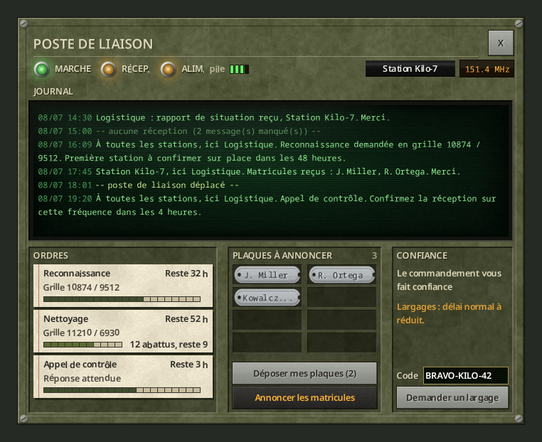
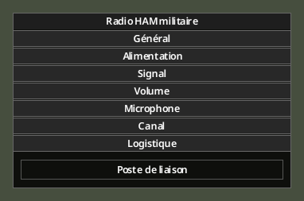

# Poste de liaison

> Version 0.8.0 : les transmissions incluent aussi **Besoins de la semaine**, **Signaler un rassemblement** et **Confirmer la réception** ; voir [missions et confiance](04-trust-and-missions.md). Une panne de relais ou un [brouilleur RJ-93](10-radio-jammer.md) peut refuser la transmission, avec un motif explicite.

[English](../en/05-liaison-post.md) · [Sommaire du guide](Home.md) · Précédent : [Confiance et missions](04-trust-and-missions.md) · Suivant : [Administration](06-server-admin.md)

Un poste de liaison est une radio militaire fixe dont votre station fait sa base. Il garde le journal de ce que dit la base, affiche vos ordres et votre confiance, et rapporte davantage pour les matricules annoncés.

*Rendu hors jeu.*

## Installer le poste

1. Posez un **Radioamateur de l'Armée américaine** (toute radio fixe haut de gamme capable d'émettre convient).
2. Alimentez-le (secteur, groupe électrogène ou pile), allumez-le, réglez-le sur la fréquence militaire.
3. Clic droit, **Options de l'appareil**. Dans la section **Logistique**, appuyez sur **Poste de liaison**.

*Rendu hors jeu.*

- La première fois, le poste est installé et la console s'ouvre.
- Chaque station a **un seul** poste. Sur une autre radio, le bouton demande *« Transférer le poste de liaison ici ? »*.
- Le bouton est grisé sur le poste d'une autre station.
- Si la radio est ramassée ou détruite, le poste est perdu. Réinstallez-le.

## La console

Le rapport quotidien et le contrôle radio ne demandent aucune radio portable : sélectionnez le rapport ou le contrôle ouvert dans la liste des affaires, puis utilisez son bouton d'action. La confirmation de reconnaissance, le statut du nettoyage et la demande de passage Fulton sont aussi disponibles. Un rapport ou contrôle déjà validé ne paie pas deux fois, même en changeant de radio. La reconnaissance exige toujours la présence de votre personnage dans sa zone.

**En haut** : trois voyants. **MARCHE** (alimenté et allumé), **RÉCEP.** (clignote à l'arrivée d'un message), **ALIM.** avec la source (secteur, groupe électrogène, pile) et la charge de la pile. À droite : votre indicatif et la fréquence.

**JOURNAL** : tout ce que la base dit à votre station ou à toutes les stations, avec la date et l'heure. Le poste ne reçoit que s'il est allumé, alimenté et réglé. Sinon, une ligne marque le trou : *« -- aucune réception (3 message(s) manqué(s)) -- »*. Le poste continue de recevoir pendant votre absence.

**ORDRES** : les missions en cours, avec la grille, le temps restant et une barre de progression. Le nettoyage affiche « 12 abattus, reste 9 » (ou « horde non repérée ») ; l'appel de contrôle, « Réponse attendue » ou « Réception confirmée ».

**PLAQUES À ANNONCER** : les plaques déposées au poste par les membres de votre station (survolez une plaque pour voir qui l'a déposée).
- **Déposer mes plaques (N)** transfère les plaques de soldats tombés de votre inventaire au poste.
- **Annoncer les matricules** les lit à la base. Les matricules annoncés depuis le poste rapportent 50 % de confiance en plus.

**CONFIANCE** (personnelle au personnage qui consulte le poste) : votre confiance en mots, et son effet sur les largages (« Largages : délai réduit. »).

**Code** et **Demander un largage** : le même appel que depuis la fenêtre radio. Le [formulaire de réquisition](03-requisition-form.md) s'ouvre à côté de la console.

La console reste ouverte quand vous utilisez ses boutons, et se ferme si vous vous éloignez de la radio.

*En jeu (version anglaise).*

> La console ne dit jamais si la radio est sur la fréquence militaire. Fiez-vous aux notes.

En 0.8.0, transmettre les données rend le boîtier dans votre inventaire. Il disparaît alors des enregistreurs à traiter du poste. L’infobulle **TooltipLib** indique **« Données déjà transmises à la base »** et précise que vous pouvez le [démonter](09-helicopter-crash.md). La récompense de confiance reste unique par site de crash. Les anciens boîtiers déjà rendus sont reconnus par le registre existant lors de l’ouverture du poste ou d’une mise à jour périodique de l’inventaire ; aucun état de mission n’est réinitialisé.

### Ordres visibles au poste

La liste **Ordres** affiche les missions actuellement ouvertes : **reconnaissance**, **nettoyage**, **appel de contrôle** et **remise en service d’un relais**. Sélectionnez un ordre pour sa grille, son délai et les consignes ; le nettoyage affiche aussi sa progression. Les actions de confirmation existantes restent accessibles selon le type de mission.

Une mission relais lancée depuis l’administration apparaît comme une panne naturelle au prochain rafraîchissement du poste. Elle indique l’armoire et les déchets électroniques à apporter. La réparation se fait physiquement sur l’armoire annoncée, jamais à distance depuis le poste. Après réparation ou liaison de secours, l’ordre disparaît.

### Missions terminées

La rubrique **Missions terminées** conserve les 20 derniers résultats de nettoyage. Sélectionnez une fiche pour consulter le résultat, la grille, la date de clôture, votre contribution et la confiance réellement reçue. Réussite, expiration et annulation sont distinguées. Ces fiches restent disponibles après reconnexion et après disparition de la coche verte temporaire ; leur consultation ne redonne aucune récompense. Les résultats antérieurs à l’installation de cette fonctionnalité ne peuvent pas être reconstitués.
